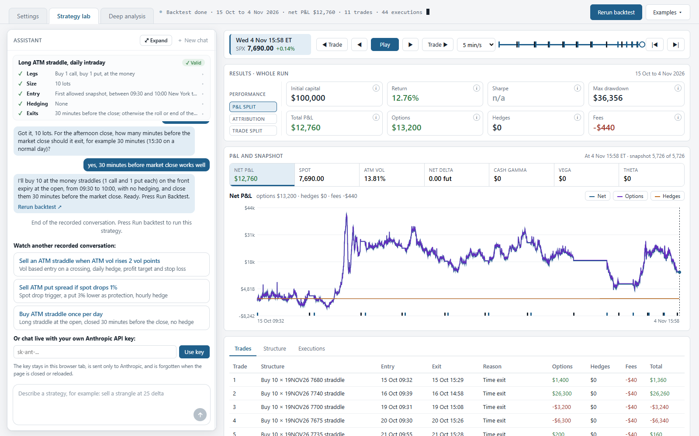
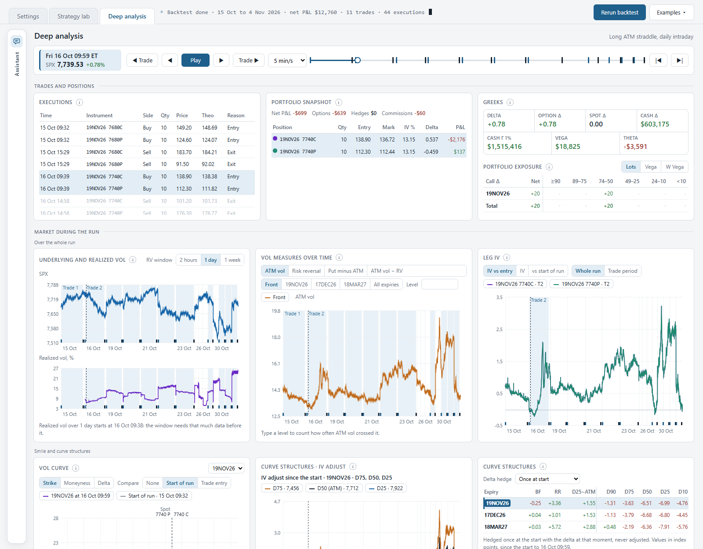

# SPX Options Backtester with an AI Strategy Assistant

A single page options research tool built on my own SPX market data pipeline. Describe a trading idea in plain English, and an AI assistant turns it into a strategy that a validator checks and the engine backtests: Black 76 pricing on the volatility smile at every snapshot, futures delta hedging, rolls, fees and P&L attribution.

**[Live demo](https://alexbuzelan.github.io/llm-spx-options-strategy-builder/)**



## What it does

1. **Describe** a strategy in the assistant, or watch one of the recorded conversations.
2. **The assistant asks** what is missing (size, entry, hedging, exits), fills in the strategy rules as you agree them, and writes the strategy.
3. **The page validates** it against a strict schema. If it fails, the errors go back to the assistant, which fixes the strategy.
4. **Run backtest** replays three weeks of SPX volatility snapshots and shows the results, the trades and every execution.
5. **Deep analysis** lets you step through the run snapshot by snapshot: positions, Greeks, exposures, realized vol and the smile.

## The five parts

### 1. Data pipeline
- Intraday SPX option market data.
- Daily aggregation and quality filtering of the option chains.
- The demo ships only the fitted smile parameters, not raw quotes (see [Data](#data)).

### 2. Volatility modelling
- At each snapshot and expiry, the implied volatility smile is fitted with a quadratic regression in moneyness. Raw SVI was also implemented and compared in the research work.
- The backtester rebuilds every option's implied vol from these fitted curves.

### 3. Pricing and hedging engine
- **Pricing:** Black 76 on the forward, with the strike's vol read from the fitted smile.
- **Fills:** options at theoretical value plus or minus a spread model, with fees per contract.
- **Strategies:** 1 or 2 legs, strikes by spot offset or delta, size in lots or by target vega.
- **Entry and exit conditions** on market measures: ATM vol, change in ATM vol, spot change, realized vol, implied minus realized vol, and two skew measures. Each condition works as a level or as a crossing.
- **Delta hedging** with SPX futures: every N hours, at the daily close, or when delta exceeds a threshold.
- **Platform rules:** front expiry only, roll 2 days before expiry at 15:00 ET, one trade at a time, profit targets, stop losses and time exits.
- **P&L attribution** per trade: costs (fills against fair value, plus fees), implied (vega times the change in vol) and realized (spot, time and hedges).

### 4. AI strategy assistant
- Built on the **Claude API with tool use** (Claude Sonnet 5.5), called directly from the browser.
- Three tools: `set_strategy` writes the strategy, `update_rules` shows the user how far each rule is agreed, `show_ideas` offers starting ideas.
- Guardrails: a strict [JSON schema](agent/strategy_schema.js), [instructions](agent/llm_instructions.js) on what the platform can and cannot do, and [chat rules](agent/chat_rules.js). Every strategy goes through the page's validator before it reaches the box; rejected drafts go back to the assistant with the errors, up to 2 automatic retries.
- The assistant never sees prices: only the conversation, the strategy and a short summary of the data.
- **In the demo:** watch recorded conversations (played through the same code, with only the API call replaced), or paste your own Anthropic API key to chat live. The key stays in your browser tab and is sent only to Anthropic.

### 5. Analytics
- **Results:** return, max drawdown, P&L split (options, hedges, fees), attribution and trade split.
- **P&L and snapshot:** net P&L, spot, ATM vol and the portfolio Greeks over the run, with a replay player.
- **Trade log:** trades, the structure at any snapshot, and every execution with its smile IV and fill IV.
- **Deep analysis tab:** portfolio snapshot, Greeks and exposure, underlying and realized vol, vol measures over time, leg IV, the vol curve and curve structures.



## Try it

- **Online:** open the live demo (link above).
- **Locally:** download the repository and open `index.html` in a browser. No build step and no server needed.
- **Examples ▾** loads one of 5 ready-made strategies; press **Run backtest**.

## Data

- SPX, 15 October to 4 November 2026: 5,726 snapshots, 3 expiries, 16,167 fitted smiles.
- Each row holds the snapshot time, expiry, spot, forward, time to expiry and the 3 quadratic coefficients. No raw option quotes are included.
- Prices in the backtest are model prices derived from these fitted curves.

## Repository

```
index.html          the page: UI, engine and chat
agent/              strategy schema, LLM instructions, chat rules
strategies/         example strategies and idea cards
replays/            recorded assistant conversations
data/               sample data (fitted smiles)
tools/              helper to bundle new recordings
```

## Limitations

- Three weeks of data on one underlying: too short for conclusions about any strategy.
- Model prices and a simple spread model.
- Front expiry only, at most 2 legs and one trade at a time.

## What I would improve next

- Backtest on traded option quotes (bid and ask) instead of model prices, over a longer history.
- Use the Raw SVI fits in the engine.
- Calendars and multi expiry structures.
- A small server side proxy so visitors can chat live without their own key.
- Publish the engine's test suite alongside the page.

## Tech

Plain HTML, CSS and JavaScript in a single page, with no framework and no build. [hyparquet](https://github.com/hyparam/hyparquet) (MIT) reads the Parquet sample data in the browser.
